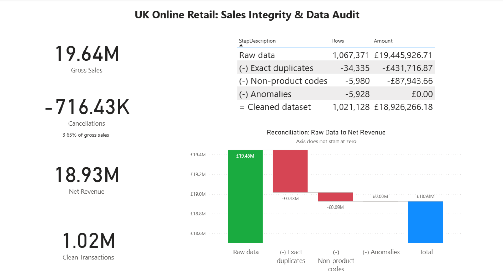
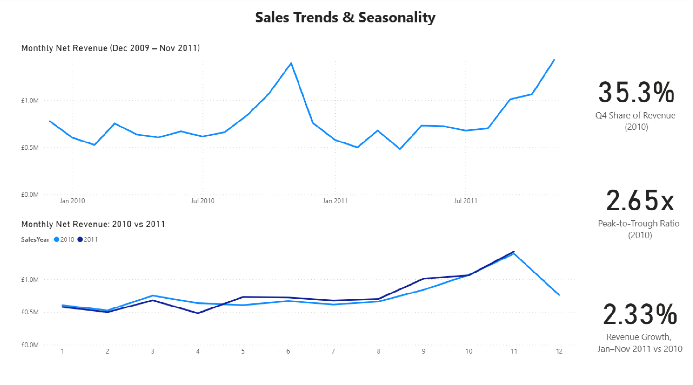
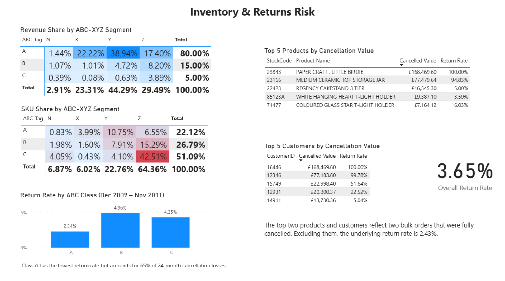

# UK Online Retailer: Sales Integrity & Inventory Optimization (2009–2011)

## 1. Business Scenario & Objectives
This project simulates the role of a Data Analyst auditing two years of transaction records (1,067,371 rows, ~1.07M) for a UK-based online gift wholesaler. The analysis addresses four core business questions from cross-functional stakeholders:

* **Finance**: *Can we trust reported sales? How much revenue is affected by cancellations, non-product charges, and data quality issues, and what is audited net revenue?*
* **Operations / Planning**: *How is net revenue trending MoM and YoY, and how strong is the seasonal peak we must plan inventory for?*
* **Supply Chain**: *Which products drive revenue, how stable is their demand, and what inventory policy fits each group?*
* **Customer Service / Quality**: *Where are cancellations and returns concentrated by product, customer, and country, and how much revenue do they cost?*

---

## 2. Data Architecture & Limitations
* **Source**: [UCI Machine Learning Repository: Online Retail II](https://archive.ics.uci.edu/dataset/502/online+retail+ii) (Dec 2009 – Dec 2011).
* **Stack**: Microsoft SQL Server (T-SQL Cleansing, Layered Views, Materialized Results), Power BI Desktop (Interactive Dashboards).
* **Limitations & Assumptions**:
  * **Partial Month**: December 2011 contains only 9 days of records and was excluded from seasonality trends, MoM/YoY growth, and ABC-XYZ demand-variability modeling.
  * **Lead Time**: A standard 4-week supplier lead time is assumed for procurement recommendations.
  * **Excluded SKUs**: Exactly 33 SKUs were excluded from ABC-XYZ classification (32 with net lifetime revenue <= £0 due to pre-dataset returns, and 1 with sales recorded solely in December 2011).
  * **Discontinued SKUs**: Items discontinued during the observation window were padded with zeros after their last recorded sale, which contributes to higher demand volatility (Class Z).

---

## 3. Data Cleansing & Control Totals Reconciliation

### Table A: Control Totals Reconciliation Waterfall
| Step | Description | Rows | Total Value (£) | Audit Commentary |
| :---: | :--- | :---: | :---: | :--- |
| **0** | **Raw Data Baseline** | **1,067,371** | **£19,445,926.71** | Sum of raw `Quantity × Price` across all imported records. |
| **1** | (-) Exact Duplicates | -34,335 | -£431,716.87 | Identical rows flagged via `ROW_NUMBER()` across all 8 columns. |
| **2** | (-) Non-Product Codes | -5,980 | -£87,943.66 | Excluded postage (`POST`, `DOT`, `C2`), discounts (`D`), bank charges, and bad-debt adjustments (`A` invoices using code `B`). |
| **3** | (-) Data Anomalies | -5,928 | -£0.00 | Excluded zero-price items and non-cancellation negative stock takes. |
| **=** | **Cleaned Dataset** | **1,021,128** | **£18,926,266.18** | Reconciled clean transaction volume. |

*(Note: Row counts and values tie out with zero variance: £19,445,926.71 - £431,716.87 - £87,943.66 - £0.00 = £18,926,266.18.)*

### Table B: Cleaned Dataset Breakdown
| Line Type | Rows | Total Value (£) | % of Gross Sales |
| :--- | :---: | :---: | :---: |
| **Gross Sales (`Quantity > 0`)** | 1,003,214 | £19,642,692.15 | 100.00% |
| **Cancellations (`Invoice` starts with 'C')** | 17,914 | -£716,425.97 | -3.65% |
| **Audited Net Revenue** | **1,021,128** | **£18,926,266.18** | **96.35%** |

---

## 4. Key Findings

### Q1: Sales Integrity & Data Quality
* **4.33% of raw rows** (46,243 rows) were identified as duplicates, non-product fees, or operational anomalies, removing **£519,660.53** in duplicated or non-merchandise value from reporting.
* Commercial cancellations reduced gross sales by **£716,425.97** (an overall business cancellation rate of **3.65%**).

### Q2: Seasonality & Operational Peak
* **Q4 Concentration**: In 2010 (the only complete calendar year), Q4 generated **£3,221,385.47**, contributing **35.26%** of total annual net revenue.
* **Peak-to-Trough Ratio**: Monthly sales peaked in November 2010 (£1.39M), which was **2.65x** the lowest month (February 2010 at £525K).
* **Ramp-up Window**: Sales climb steadily from **September** (MoM growth +27.02%), rising through October (£1.07M) to the November peak.
* **Post-Peak Drop**: December drops by **-45.64% MoM**, followed by a further **-23.64% MoM drop** in January.
* **Like-for-Like Annual Growth**: Comparing matching 11-month windows (Jan–Nov), 2011 net revenue grew by **+2.33% YoY** (£8.57M vs £8.38M), while Average Order Value (AOV) expanded by **+8.8%** (£420.40 vs £386.38).

### Q3: ABC-XYZ Inventory Matrix
*Evaluated across 24 complete months (Dec 2009 – Nov 2011; £18.49M net revenue base) with zero-padding starting strictly from each SKU's first active selling month:*
* **Revenue Pareto**: Top **22.12% of SKUs** (Class A) generate **80.00%** of net revenue.
* **Seasonal Drivers (AY)**: 504 SKUs generate **£7,198,625.21 (38.94% of revenue)**, representing high-volume, seasonal, moderately variable demand.
* **Consistent Core (AX)**: 187 SKUs generate **£4,108,236.27 (22.22% of revenue)** with steady demand (CV < 0.5).
* **New Launches (N)**: 322 SKUs (< 6 months of history) accounted for **£537,052.05 (2.91%)**, with Category **AN** capturing 39 high-performing new launches (£265K).
* **Long Tail (CZ)**: **1,993 SKUs (42.51% of catalog)** generated only **3.89%** of net revenue (£718.7K), which are likely to carry disproportionate holding and handling costs.

### Q4: Cancellation & Return Hotspots
* **Product Concentration**: A-class items accounted for **65.49% of 24-month cancellation losses** (£354K), despite having the lowest group cancellation rate (**2.34%** vs 4.96% for Class B).
* **B2B Bulk Cancellations**: Two single orders accounted for **34.3%** of all cancellation losses (£245.7K):
  * Customer `16446` (09-Dec-2011): Cancelled 80,995 units of `23843` (*PAPER CRAFT, LITTLE BIRDIE*), losing **£168,469.60** (100% cancellation rate). Cancelled within 12 minutes of order placement.
  * Customer `12346` (18-Jan-2011): Cancelled 74,215 units of `23166` (*MEDIUM CERAMIC TOP STORAGE JAR*), losing **£77,183.60** (99.8% cancellation rate). Cancelled within 16 minutes of order placement.
* **Underlying Return Rate**: Both instances most likely reflect input errors or immediate order reversals rather than product dissatisfaction. Excluding these two anomalous wholesale cancellations, the underlying return rate drops to **2.43%** (£470,772.77 losses on £19,396,866.69 adjusted gross revenue).
* **Geographic Focus**: The UK accounted for **88.23%** of all cancellation losses (£632K; 3.76% return rate). **Spain** exhibited an elevated return rate of **13.25%** (£13.0K losses on £97.8K gross sales).

---

## 5. Strategic Recommendations

| Department | Strategic Recommendation | Rationale |
| :--- | :--- | :--- |
| **Finance** | Enforce separate general ledger accounts for shipping/freight fees (`POST`, `DOT`) and bank charges, and establish a monthly automated control-totals reconciliation process. | Duplicates (£432K) and non-product charges (£88K) together distorted product revenue by ~£520K; separating fees and automating reconciliation prevents both. |
| **Supply Chain** | **For Category AX**: Prioritize supplier allocations and maintain higher safety stocks. **For Category CZ**: Shift towards on-demand replenishment or order-to-purchase. | Protects 22% of revenue from stockouts while reducing catalogue complexity: these SKUs make up 42.5% of the range. |
| **Operations (Planning)** | Initiate Q4 inventory build-up by **early August** to accommodate 4-week supplier lead times before the September surge. **Halt reordering of seasonal holiday SKUs by mid-November**. | Maximizes fulfillment during the peak surge (35.3% of revenue) while limiting post-holiday overstock. |
| **Commercial / Quality** | Introduce confirmation checkpoints for orders with quantities far exceeding historical customer norms. Investigate the operational drivers of Spain's elevated return rate (13.25%). | Prevents six-figure cancellation shocks (£245K+ from rapid cancellation mistakes) and helps determine whether Spain's elevated return rate is driven by a few customers or a broader logistics issue. |

---

## 6. Power BI Dashboards

### Page 1: Executive Summary & Data Integrity

*Features executive KPI cards, 4-step reconciliation waterfall chart, and audited control totals table.*

### Page 2: Sales Trends & Seasonality

*Displays 24-month continuous revenue trend, 2010 vs 2011 like-for-like seasonality overlay, and key Q4 concentration metrics.*

### Page 3: Inventory & Returns Risk (ABC-XYZ)

*Presents the ABC-XYZ heatmap matrices (Revenue vs SKU share), return rates across ABC tiers, and Top 5 cancellation drill-downs.*

---

## 7. Project Structure
```text
├── sql/
│   ├── 01_clean_and_reconciliation.sql           # Data cleansing & reconciliation waterfall
│   ├── 02_monthly_trend_and_seasonality.sql      # Seasonality, MoM/YoY growth & Q4 metrics
│   ├── 03_abc_xyz_matrix.sql                     # ABC-XYZ classification & materialized table
│   └── 04_cancellation_and_returns_analysis.sql  # SKU, customer, and country return hotspots
├── dashboard/
│   ├── 01_executive_summary.png
│   ├── 02_trends_seasonality.png
│   ├── 03_inventory_returns_risk.png
│   └── retail_audit_dashboard.pbix
├── Data_Quality_Log.md
└── README.md
```
